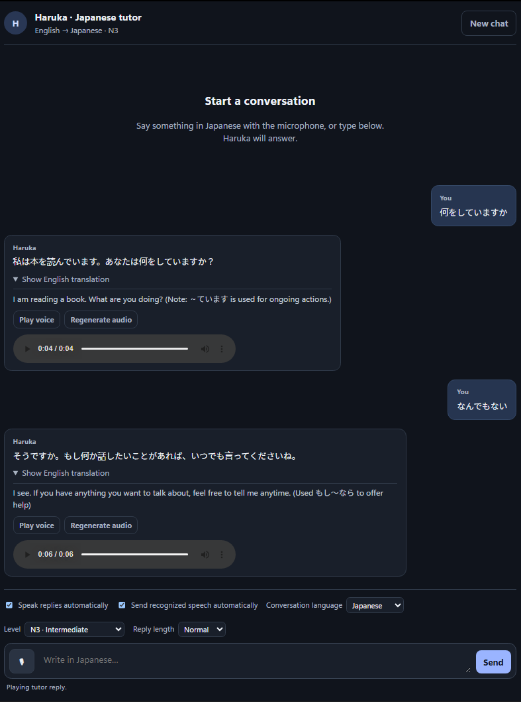

# Voice Language Tutor

Practice a conversation with an AI language tutor. Speak or type, receive a reply in your target language, and listen to it with locally generated speech.

## Release downloads

Download the release archive for your operating system from [GitHub Releases](https://github.com/07ishaan/voice-language-tutor/releases):

- **Windows:** `VoiceTutor-v2.0.0-Windows.zip` (release `v2.0.0`)
- **Linux:** `VoiceTutor-Linux-v2.1.0.tar.gz` (release `v2.1.0`)
- **macOS:** `VoiceTutor-macOS-v2.1.0.tar.gz` (release `v2.1.0`)

Extract the archive, then follow the setup instructions for your operating system below.

## Windows setup

1. Install or create a [Groq API key](https://console.groq.com/keys).
2. Download or extract this repository, then double-click `start.bat`.
3. On first run, the launcher installs Python 3.11 if needed, creates a private `.venv`, and installs the app and Chatterbox text-to-speech dependencies. If Chrome is missing, it offers to install Chrome through `winget`.
4. Enter your Groq API key in the masked setup dialog. The key is saved in the local `.env` file and is not included in the shareable package.
5. Optionally enter the path to a WAV reference recording for a custom voice. Press Enter to use Chatterbox's built-in voice. Only use a recording you made or have permission to use.
6. The tutor opens in a Chrome app window. Close that window to stop the local server.

## Linux setup

1. Install Python 3.11 and its `venv` support using your Linux distribution's package manager. The launcher does not run `sudo` or change system packages.
2. Extract this repository, open a terminal in the extracted folder, and run `chmod +x start.sh && ./start.sh`.
3. On first run, the launcher creates a private `.venv` and installs the app and Chatterbox dependencies. Enter your Groq API key in the masked dialog or terminal prompt; the key is saved in `.env` on this computer.
4. Optionally provide a WAV reference recording for a custom voice, or press Enter to use the built-in voice. The app opens in your default browser. Close its tutor tab to stop the local server.

## macOS setup

1. Install Python 3.11. If it is missing and Homebrew is installed, `start.sh` offers to install Python 3.11 with Homebrew; otherwise install Python 3.11 first.
2. Extract this repository. Double-click `start-macos.command`, or open Terminal in the extracted folder and run `./start.sh`. If macOS blocks the first launch, Control-click `start-macos.command` and choose **Open**.
3. On first run, the launcher creates a private `.venv` and installs the app and Chatterbox dependencies. Enter your Groq API key in the masked dialog or terminal prompt; the key is saved in `.env` on this Mac.
4. Optionally provide a WAV reference recording for a custom voice, or press Enter to use the built-in voice. The app opens in your default browser. Close its tutor tab to stop the local server. Apple Silicon Macs use PyTorch's MPS device when available; other Macs use CPU.

Plan for roughly 8–9 GB after setup: about 5–6 GB for Python, PyTorch, and app dependencies, plus about 3 GB for the Chatterbox speech model. Keep at least 12 GB free during first setup to allow for temporary download and installer files. The exact amount varies by operating system and hardware. The model downloads the first time the server starts; allow a few minutes and keep the computer online. Later launches reuse the installed environment and model.

## Conversation controls

- **Conversation language:** choose the language you want to practice. The tutor replies in that language, and speech recognition is configured for it.
- **Level:** choose a Japanese JLPT level from N5 through N1, or a CEFR level for other languages. The tutor adjusts its vocabulary and grammar to the selected level. Language and level choices are remembered in this browser.
- **Reply length:** choose Short, Normal, or Detailed to control how much the tutor says in each response.
- **English translation:** open **Show English translation** below a reply when you need its translation and learning note.
- **Audio:** generated speech stays with its reply for replay during the conversation. Choose **Regenerate audio** to create a fresh version.
- **Saved chats:** choose **Save chat** to save the conversation in this browser, then open it later from **Saved chats**. Reopened chats restore their messages, translations, and language settings; audio is generated again when you play a reply. Continuing a saved chat updates that saved copy.
- **Speak replies automatically:** have the tutor play audio as soon as a reply is ready, or use **Play voice** when you want to listen.
- **Send recognized speech automatically:** send a recognized utterance right away, or turn this off to review and edit it before sending.
- **New chat:** clear the current conversation and start again.

## Voice and character setup

Chatterbox runs locally and supports speech generation without a separate Voicebox installation. A reference WAV is optional; leaving the path empty uses Chatterbox's built-in voice. The model adds an inaudible watermark to generated audio.

To customize the tutor, edit a JSON file under `characters/` or copy one of the examples. Set `CHARACTER` in your local `.env` to the file name without `.json`, then restart the app. Keep local settings, API keys, reference recordings, and private character files out of public commits.

To create a shareable Windows ZIP, run `package-for-other-pc.ps1`. Run `python package-unix.py` to create separate `VoiceTutor-Linux-v2.1.0.tar.gz` and `VoiceTutor-macOS-v2.1.0.tar.gz` archives. The packages include the app and example character, but exclude `.env`, `.venv`, local characters, and voice recordings. On another computer, extract its archive and launch with `start.bat` (Windows), `./start.sh` (Linux), or `start-macos.command` (macOS); that computer can provide its own Groq key and optional reference WAV during setup.

## Troubleshooting

- **Setup reports an error:** confirm the computer is online and has several GB of free disk space, then run its launcher again. The launcher checks dependencies and resumes installation.
- **Groq/API error:** check the key in `.env`. Leave `GROQ_MODEL` empty to let the app choose an available model automatically.
- **No speech audio:** allow the initial Chatterbox model download to finish, then check the server window for `[tts]` errors.
- **Microphone input fails:** open the app in Chrome or Edge, allow microphone access, and check that no other app is using the microphone.

## License

[MIT License](LICENSE).
